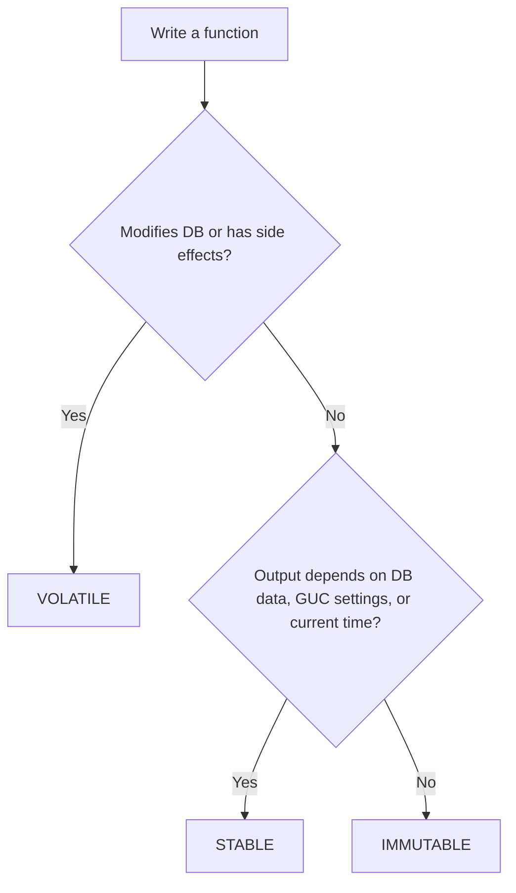

# PostgreSQL Function Volatility: IMMUTABLE vs STABLE vs VOLATILE

## Why this matters

- Volatility is a **promise** you make to the planner about your function
- The planner trusts it blindly, it does **not** verify
- Wrong label → wrong results or slow queries
- Right label → index usage, caching, constant folding

---

## Environment

- Image: `postgres:19beta3`
- Container: `pg19`, host port `5019`

```bash
podman run -d --name pg19 \
  -e POSTGRES_PASSWORD=postgres \
  -p 5019:5432 \
  docker.io/library/postgres:19beta3

podman exec -it pg19 psql -U postgres
```

---

## The three categories at a glance

| Category | Reads DB? | Same input → same output? | Within one statement | Real-life analogy |
|---|---|---|---|---|
| `IMMUTABLE` | No | Always, forever | Can be folded at plan time | Math: `2 + 2` |
| `STABLE` | Yes (read only) | Same within one statement | Result fixed per statement | Today's date, a lookup table |
| `VOLATILE` (default) | Yes / writes | Can change any call | Re-run on every row | Random number, sequence, audit insert |



---

## Setup: sample data

```sql
CREATE TABLE orders (
    order_id    serial PRIMARY KEY,
    customer    text,
    amount      numeric(10,2),
    created_at  timestamptz DEFAULT now()
);

INSERT INTO orders (customer, amount, created_at)
SELECT 'cust_' || (g % 1000),
       round((random() * 1000)::numeric, 2),
       now() - (g || ' minutes')::interval
FROM generate_series(1, 200000) g;

ANALYZE orders;
```

---

## 1. IMMUTABLE

### Rule

- Output depends **only** on the arguments
- No table reads, no `now()`, no `random()`, no session settings
- Safe for **expression indexes**

### Real-time example: GST calculation (India)

```sql
CREATE OR REPLACE FUNCTION gst_amount(p_amount numeric)
RETURNS numeric
LANGUAGE sql
IMMUTABLE
AS $$ SELECT round(p_amount * 0.18, 2) $$;

SELECT gst_amount(1000);   -- 180.00
```

### Real-time example: expression index

```sql
CREATE OR REPLACE FUNCTION norm_cust(p text)
RETURNS text
LANGUAGE sql
IMMUTABLE
AS $$ SELECT upper(trim(p)) $$;

CREATE INDEX idx_orders_norm_cust ON orders (norm_cust(customer));

EXPLAIN (ANALYZE, COSTS OFF)
SELECT * FROM orders WHERE norm_cust(customer) = 'CUST_42';
-- Expect: Bitmap Index Scan on idx_orders_norm_cust
```

### What goes wrong if you label it wrong

```sql
-- WRONG: depends on current time, but marked IMMUTABLE
CREATE OR REPLACE FUNCTION bad_today()
RETURNS date
LANGUAGE sql
IMMUTABLE
AS $$ SELECT current_date $$;

-- Index creation will accept it, but the stored index values go stale
CREATE INDEX idx_bad ON orders (bad_today());
```

- Index built today keeps today's value
- Tomorrow queries return **wrong results**
- PostgreSQL does not stop you

---

## 2. STABLE

### Rule

- Can **read** the database, cannot modify it
- Same arguments → same result **within a single statement**
- May differ between statements
- Cannot be used in an index expression

### Real-time example: lookup table (tax rate)

```sql
CREATE TABLE tax_rates (
    category text PRIMARY KEY,
    rate     numeric(5,4)
);
INSERT INTO tax_rates VALUES ('standard', 0.18), ('reduced', 0.05);

CREATE OR REPLACE FUNCTION get_rate(p_cat text)
RETURNS numeric
LANGUAGE sql
STABLE
AS $$ SELECT rate FROM tax_rates WHERE category = p_cat $$;

SELECT order_id, amount, amount * get_rate('standard') AS tax
FROM orders
LIMIT 5;
```

### Real-time example: time-dependent filter

```sql
CREATE OR REPLACE FUNCTION recent_cutoff()
RETURNS timestamptz
LANGUAGE sql
STABLE
AS $$ SELECT now() - interval '1 hour' $$;

CREATE INDEX idx_orders_created ON orders (created_at);

EXPLAIN (ANALYZE, COSTS OFF)
SELECT count(*) FROM orders WHERE created_at > recent_cutoff();
-- STABLE is evaluated once, then used as an index condition
```

---

## 3. VOLATILE (default)

### Rule

- Result can change on **every call**, even within one statement
- May modify the database
- Planner cannot cache, fold, or skip calls

### Real-time example: audit logging

```sql
CREATE TABLE audit_log (
    id        serial PRIMARY KEY,
    msg       text,
    logged_at timestamptz DEFAULT clock_timestamp()
);

CREATE OR REPLACE FUNCTION log_event(p_msg text)
RETURNS void
LANGUAGE sql
VOLATILE
AS $$ INSERT INTO audit_log(msg) VALUES (p_msg) $$;

SELECT log_event('order ' || order_id) FROM orders LIMIT 3;
SELECT * FROM audit_log;   -- 3 rows, one per input row
```

### Real-time example: random sampling

```sql
SELECT order_id, random() FROM orders LIMIT 3;
-- random() is VOLATILE: different value per row
```

---

## Side-by-side demo: call count

```sql
CREATE OR REPLACE FUNCTION f_imm(i int) RETURNS int LANGUAGE plpgsql IMMUTABLE AS
$$ BEGIN RAISE NOTICE 'IMMUTABLE called'; RETURN i; END $$;

CREATE OR REPLACE FUNCTION f_stb(i int) RETURNS int LANGUAGE plpgsql STABLE AS
$$ BEGIN RAISE NOTICE 'STABLE called'; RETURN i; END $$;

CREATE OR REPLACE FUNCTION f_vol(i int) RETURNS int LANGUAGE plpgsql VOLATILE AS
$$ BEGIN RAISE NOTICE 'VOLATILE called'; RETURN i; END $$;

-- Constant argument, 3 rows
SELECT f_imm(1) FROM generate_series(1,3);   -- 1 notice (folded at plan time)
SELECT f_stb(1) FROM generate_series(1,3);   -- 3 notices in SELECT list
SELECT f_vol(1) FROM generate_series(1,3);   -- 3 notices
```

- `IMMUTABLE` with constant args → evaluated **once** during planning
- `STABLE` and `VOLATILE` in the SELECT list → called per row
- `STABLE` in a WHERE clause on an indexed column → evaluated once for the index scan
- `VOLATILE` in a WHERE clause → cannot be used as an index condition, evaluated per row

### WHERE clause comparison

```sql
CREATE OR REPLACE FUNCTION w_stb() RETURNS timestamptz LANGUAGE sql STABLE
AS $$ SELECT now() - interval '1 hour' $$;

CREATE OR REPLACE FUNCTION w_vol() RETURNS timestamptz LANGUAGE sql VOLATILE
AS $$ SELECT now() - interval '1 hour' $$;

EXPLAIN (ANALYZE, COSTS OFF) SELECT count(*) FROM orders WHERE created_at > w_stb();
-- Index/Bitmap scan

EXPLAIN (ANALYZE, COSTS OFF) SELECT count(*) FROM orders WHERE created_at > w_vol();
-- Seq Scan (function re-evaluated for every row)
```

---

## Built-in function examples

| Function | Volatility |
|---|---|
| `upper()`, `abs()`, `length()` | IMMUTABLE |
| `now()`, `current_date`, `transaction_timestamp()` | STABLE |
| `clock_timestamp()`, `random()`, `nextval()` | VOLATILE |

```sql
SELECT proname, provolatile
FROM pg_proc
WHERE proname IN ('upper','now','random','clock_timestamp','nextval');
-- i = immutable, s = stable, v = volatile
```

---

## Cheat sheet

| Question | Answer |
|---|---|
| Used in an index expression? | Must be `IMMUTABLE` |
| Used in a generated column? | Must be `IMMUTABLE` |
| Reads a table? | At most `STABLE` |
| Writes, logs, uses sequences? | `VOLATILE` |
| Uses `now()` or `current_date`? | `STABLE` |
| Uses `random()` or `clock_timestamp()`? | `VOLATILE` |
| Depends on `search_path`, `TimeZone`, or locale? | Not truly `IMMUTABLE`, use `STABLE` |
| Unsure? | Leave it `VOLATILE` (safe, slower) |

---

## Troubleshooting

| Symptom | Likely cause | Fix |
|---|---|---|
| `functions in index expression must be marked IMMUTABLE` | Function is STABLE or VOLATILE | Make it truly immutable, or avoid the index |
| `generation expression is not immutable` | Generated column uses non-immutable function | Wrap in a real IMMUTABLE function |
| Query does Seq Scan despite an index | Function in WHERE is VOLATILE | Mark STABLE if safe |
| Index returns stale or wrong rows | Function wrongly marked IMMUTABLE | Re-label, then `REINDEX` |
| Function called too many times | VOLATILE in a hot path | Downgrade to STABLE if it has no side effects |
| Function result "stuck" in a query | Marked STABLE or IMMUTABLE but changes mid-statement | Mark VOLATILE |

---

## Cleanup

```bash
podman rm -f pg19
```

---

## Key takeaways

- Volatility is a **contract**, not a measurement
- `IMMUTABLE` → same input, same output, forever
- `STABLE` → same within one statement
- `VOLATILE` → anything can happen
- Default is `VOLATILE`; tighten it only when it is truly safe
- Mislabeling gives silent wrong results, not an error
